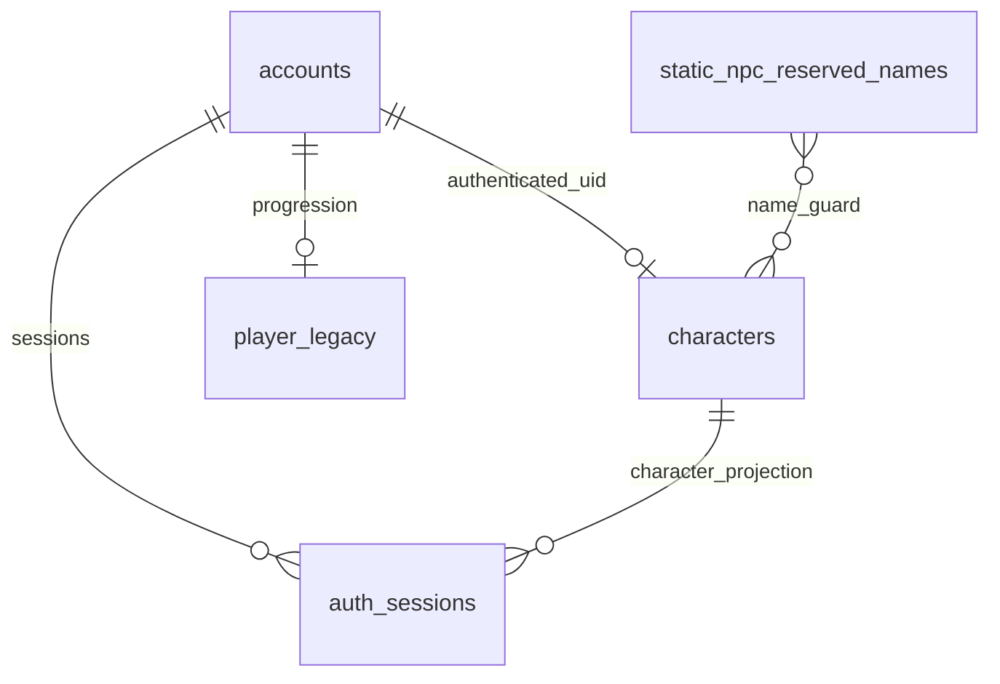
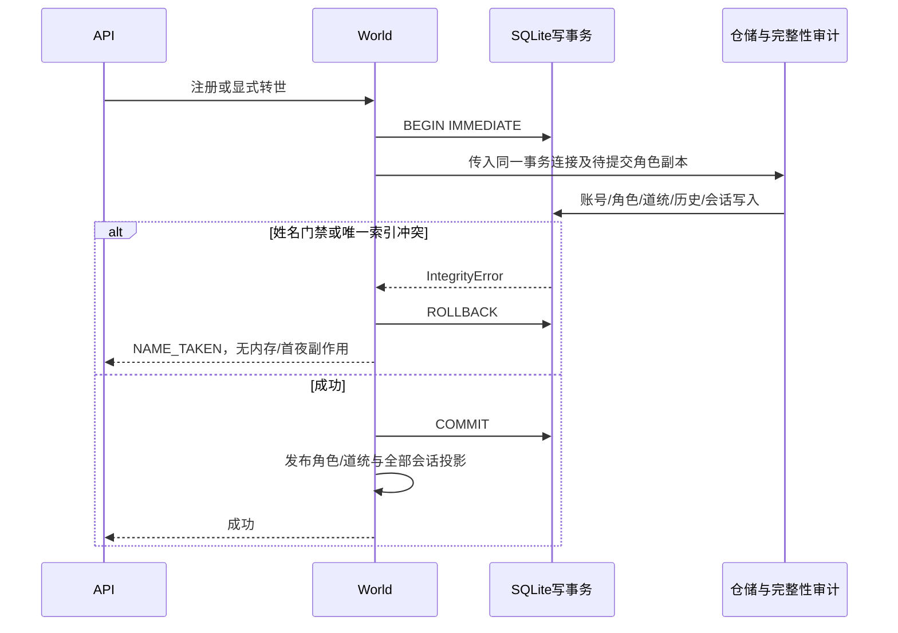

## PROX-12：裁定同步与架构评审准备

- Date: 2026-11-03
- Status: design-preparation-only; not-independent-review-or-implementation
- Branch: `feat/character-integrity-and-audit-rules`
- HEAD: `41c64ef8e871631cf3a25db0d913249c8bd2c487`
- 原后端设计基线：`4bf5a4c35386c56b2e9809724d08af8aa8511a2e`

### 结论与本轮范围

“继续推进”落实为同步已裁定 Spec 与补齐阶段三输入，不再重复要求选择方案。负责人只放行进入评审：PROX-15 仍 todo，仅有运行时重连失败记录、无方案交付；PROX-16–19 仍 backlog，无阶段四实现任务。请负责人恢复阶段二任务，交付后提升评审。本轮不代写前端、不自行重派、不提前出独立评审结论。

### 五步细化增量

1. 本质：把口头“继续”收敛为可检查的评审材料与明确流程交接，不把进入评审误作编码许可。
2. 可行性：沿用 Python/SQLite/原生 JS 单体。连接工厂替换为机械覆盖面，不引入连接池、框架或 ORM。
3. 盲区：仓储独立 commit/close、内存版本先增、反向触发器误挡同 uid upsert、启动静态保留名与迁移互相阻断、Unicode 版本升级后索引排序变化。
4. 举一反三：审计工厂覆盖后台线程和外部维护；失败原子性同时覆盖 SQL、Python 对象、会话与首夜事件，而不只看角色行数。
5. 完善：本轮确定覆盖清单、事务所有权、迁移顺序、待签字接口项；不变更已定产品规则，真实执行另批。

### 连接覆盖：新鲜仓库勘察

执行 `rg -n 'sqlite3\.connect' storage/db.py` 与 `rg -n 'sqlite3\.connect' tests`：仓储 **51 处**、测试 **10 处**。这是文本直连数，不是已完成替换或运行时覆盖率。

| 范围 | 事实与实现期签字要求 |
|---|---|
| `storage/db.py:19` 及各 Repository | 工厂创建连接时安装 DAO_NAME；init_db/读写仓储均覆盖，不能只启动注册 |
| `server/world.py:104`、`server/app.py:410` 后台线程 | 通过相同仓储工厂取得各线程连接，不跨线程共享单一连接；当前无连接池，不新增池 |
| 4 个直接连接测试文件 | auth_hardening 1、jianghu_sim 6、list_alive_resilience 2、living_jianghu 1；按用途安装排序规则或明确只读/缺失规则反例，不能统一跳过 |
| 迁移与备份工具 | 连接和 quick_check 同样需要 DAO_NAME；不导入 WORLD 或开启后台线程，显式指定目标副本 |
| 外部 SQLite 工具 | 未安装规则的相关写入应明确失败；不得把此类 OperationalError 映射成 NAME_TAKEN；记录兼容限制 |

工厂须在调用时解析当前 DB_PATH，避免默认参数提前捕获真实路径导致测试 monkeypatch 失效；应用连接拒绝隐式造库/未迁移库，迁移与测试创建入口显式开启。排序比较为纯函数，不在比较器内查询 DB、记录事件或写盘。

### 逻辑数据模型（不是新增外键承诺）



现有字符/会话关系为逻辑投影，不借本单重建全部外键。静态保留名表只保存 ROSTER 显示名，唯一比较使用 DAO_NAME；动态 NPC 名从 characters 判定。不得把规范化 name_key 引入第二真源。

### 索引与门禁顺序

- 部分索引只保证玩家-玩家唯一；触发器保证玩家-静态/NPC 双向占用拒绝。所有比较明确 COLLATE DAO_NAME，避免某一分支退回默认二进制比较。
- INSERT 与 UPDATE(name/user_id) 都覆盖。角色仓储按 uid upsert，转世可能替换 id；门禁自排除按同一 uid，不能只排 id，否则新 id 的同 uid 新生会被旧行误挡。
- NPC-NPC 重名继续允许，玩家不可借 NPC UID 命名空间绕过；账号 uid 只能服务端创建，客户端 uid 不可信。
- 静态保留名初始化不能触发自动改存档。离线预检 → 候选分配 → 同事务改名 → 安装/验证索引与双向门禁 → quick_check/统计 → 提交；非法 JSON/受保护行冲突/快照漂移一律停下。
- 重跑不 DROP/重建门禁或改名；只验证 schema 与定义一致。Unicode 归一算法/运行时版本变化时需要显式检查排序兼容性并审批重建，不能无声 REINDEX。

### 跨仓储事务与对象回滚



- 外层事务唯一拥有 commit/rollback/close；借用连接的 Repository 不得自行提交或关闭。默认非事务调用仍保留既有独立行为。
- `CharacterRepository.save` 继续六大审计，但 `character.version` 当前在落盘前递增；需在待提交副本上工作或恢复失败对象，防 SQL 回滚而内存已扣点/增版本。
- `_settle_if_needed`、Legacy、Chronicle、AuthSession 均接同一连接；失败不新增过去世、不消费道统、不替换内存 Session、不签发 token。同 uid 旧会话的持久姓名/id 一并提交，内存投影提交后发布。
- 首夜 AI、任务等放在 commit 后；不得失败后重放这些副作用。审计门禁之外的错误保留真实类别，不统统伪装冲突。

### API 与 QA 待签字项

- 已定：INVALID_NAME 按归一后 2–12；注册 409 NAME_TAKEN；缺角色 login 409 CHARACTER_MISSING；action 业务失败不改既有传输约定；已死续玩沿旧名。
- 小契约缺口：负责人规定 join 缺角色必须失败，但尚未明确 HTTP 状态。建议与 login 一致 409，交阶段三签字，不擅自把建议当定稿。
- PROX-19 独立统计采用 `accounts LEFT JOIN characters ON characters.user_id=accounts.user_id WHERE characters.user_id IS NULL`；真实受影响账号不为零须上报负责人，不以已有角色行数推断零。
- 迁移例外只允许改 name 与 data_json.name/auth_sessions.name，不运行普通 save 的版本递增/自愈。批准快照中的账号/NPC 原始行指纹、索引/门禁定义、失败回滚、二次零变更均由 QA 独立复核。

### 本轮自查证据与快照提醒

Windows / Python 3.11.0 / SQLite 3.38.4；以 `@'…'@ | .\.venv\Scripts\python.exe -` 前台运行 :memory: SQL 诊断，不导入应用。

```text
uid_python_sql_equivalence: 18/18
name_comparison_examples: 12/12
application_imports: 0
persistent_database_writes: 0
```

UID 覆盖字面前后缀、空值、大小写、伪前缀；姓名覆盖全角、Unicode 空白、大小写、ß/SS、拉丁重音及繁简不等价。仅为比较规则设计实验，不是应用测试、迁移演练或独立评审。

交付前执行同一 Python 的文档校验（stdin）与 `git diff --check`：两份文档 UTF-8/末尾换行/尾空白/代码围栏/HEAD 检查 2/2，Spec 必要章节 8/8，差异检查 exit 0；git diff --name-only 仅有既存 AGENTS.md 改动，业务/UI 无本轮 diff。本轮两次当前库 SHA256 相同；未将跨轮变化说成“上次到本次未变”。

当前真实库读取 SHA256 为 `ae9411e33228a416e835e4528ed0d25e8ceed5c8c5b995da3c15b72ac08fbf8c`，已不同于 11-02 的 `9c5a672a247a745a29351d6751005d64dd0230bccb42c043530b72866ba04336`。这证明旧统计不能当当前快照，不证明数据库损坏。本轮未执行任何应用或写库操作；不擅自迁移、清理或更新受保护账号口径，交 QA 按新快照复核。

### 下一步

负责人恢复 PROX-15 → 交付后提升 PROX-16–19 → 全员清空问题、签字定稿 → 正式派发实现。PROX-12 保持 in_progress，本轮无独立 Review/QA 准出、无业务/UI 改动、无迁移、无提交推送。
