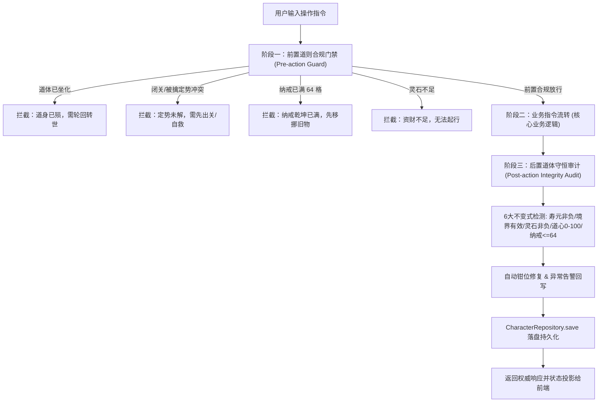

# Spec: 修士道体数据合规守恒与全功能基准校验系统 (Character Integrity & Audit Rule)

## 1. Problem Statement (问题陈述)
修仙游戏体系具备高度交织的多维状态（境界、寿元、道心、业力、灵石、法宝装备、纳戒容量、战力衍生、周天定势）。
此前各模块（历练、挖宝、坊市、锁妖塔、穿戴、突破、宗门）各自为政分散计算，缺乏全生命周期的**前置道则准入（Pre-condition Check）**与**后置道体守恒审计（Post-action Audit）**，易滋生以下隐患：
1. **死者行动与状态穿透**：寿元耗尽（`rem_years <= 0`）或状态已为 `DEAD` 的修士，依然可接收跑图、挖宝、接任务等世俗指令；
2. **定势冲突**：修士处于「九天辟谷闭关（`MEDITATING`）」或「被擒拿（`CAPTURED`）」等独占状态时，部分新旧指令未拦截放行；
3. **资财赤字**：高频并发或未验资扣减，导致灵石、道心或寿元下溢变为负数；
4. **纳戒爆仓吞物**：背包满 64 格时，产出型操作未前置阻断，导致新掘出的神兵仙丹或买入货物静默丢失；
5. **规范缺失**：缺乏长效开发铁律，后续新增功能若开发者疏漏，容易再次埋下数据不一致隐患。

---

## 2. Design Proposal (架构与解决方案)

### 2.1 整体架构流程

### 2.2 核心模块规范
1. **道体合规守恒核心引擎 (`core/character_integrity.py`)**：
   - `CharacterIntegrity.assert_alive(char)`：核验修士是否存活，剩余寿元是否 $> 0$；
   - `CharacterIntegrity.assert_idle(char, allowed_actions=None)`：核验修士是否处于自由行动态（排查闭关、被擒）；
   - `CharacterIntegrity.assert_currency(char, cost_stones)`：核验修士随身灵石充足（$\ge cost \ge 0$）；
   - `CharacterIntegrity.assert_bag_space(char, needed_slots=1)`：核验百宝纳戒未满（$len(items) + needed \le 64$）；
   - `CharacterIntegrity.audit_character(char, auto_repair=True)`：全量 6 大不变式后置审查，自动修复边缘下溢并记录天道警示。
2. **服务端全局切面挂载 (`server/world.py`)**：
   - 指令前置门禁：在 `/前往`, `/挖宝`, `/做`, `/探险`, `/任务`, `/拜入`, `/突破`, `/摆摊`, `/寄售`, `/施法`, `/打坐` 等所有指令入口集中校验；
   - 存档后置卫士：在 `CharacterRepository.save` 前挂载道体数据审查。
3. **全局开发铁律固化 (`AGENTS.md` / `GEMINI.md`)**：
   - 正式将【基准规则：修士道体合规与守恒校验】追加至项目规范，所有未来新功能与重构必须遵循此标准。

---

## 3. Out of Scope (明确不做范围)
1. 不剥夺玩家合法「燃寿」（如血遁秘术）的权利，但在燃寿到 0 时必须立即判死并触发天道坐化；
2. 不破坏既有的物品实体与装备词缀结构，保持向前兼容性；
3. 不影响离线玄黄镜演（Demo）模式的独立演化。

---

## 4. Implementation Tasks (任务拆解)

- [x] **Task 1: 构建道体合规守恒核心引擎** (`core/character_integrity.py`, `tests/test_character_integrity.py`)
  - 实现 6 大修仙要素不变式校验函数与权威审计器 `CharacterIntegrity`；
  - 编写单元测试验证寿元边界、灵石非负、道心钳位、纳戒满格判定与自动修复（7/7 passed）。
- [x] **Task 2: 服务端业务指令全局前置门禁与后置审计切面** (`server/world.py`, `storage/db.py`)
  - 在移动、探索、挖宝、宗门、闭关、突破、交易等指令入口注入权威前置拦截；
  - 在保存修士数据时注入后置一致性审计，杜绝脏数据落盘。
- [x] **Task 3: 全局开发规则沉淀与长效治理约束** (`AGENTS.md`, `GEMINI.md`)
  - 在全局开发规范中增加【基准开发规则：道体数据合规守恒律】，定义新功能的必做检查表。
- [x] **Task 4: 全链路异常场景端到端测试与全量回归** (`tests/test_character_integrity_flow.py`)
  - 编写端到端测试验证：死者行动拦截、闭关行动拦截、灵石透支拦截、纳戒满格产出拦截、后置入库审计自愈（3/3 passed）；
  - 运行回归套件确保系统零破坏（sanctum + dungeon 9/9 passed）。

### 拆细完善落地进展 (Deepened Sub-tasks)
- [x] **Task 2.1: 坊市交易与资金流验资闭环** (`core/market.py`, `tests/test_market_integrity.py`)
  - 商会购药/阵盘、寄售买单、金库寄存全面调用 `assert_alive`、`assert_bag_space`、`assert_currency` 与 `deduct_currency`，杜绝赤字（5/5 passed）。
- [x] **Task 2.3: 挖宝系统防爆仓吞宝与定势排他门禁** (`core/treasure_system.py`, `tests/test_treasure_integrity.py`)
  - 寻龙勘探挖宝入口严格核验纳戒剩余容量，满 64 格前置阻断并提示移挪旧物，同时拦截死者与闭关/被擒修士（4/4 passed）。
- [x] **Task 2.2: 炼丹炼器验资与开炉成品纳戒防吞** (`core/alchemy.py`, `tests/test_alchemy_integrity.py`)
  - 开炉前置核验纳戒容量、炉火灵石资产与修士定势，使用 `deduct_currency` 扣除炉火灵石（3/3 passed）。
- [x] **Task 2.4: 副本秘境与历练探险开箱防吞物** (`core/dungeon.py`, `core/adventure.py`, `tests/test_dungeon_adventure_integrity.py`)
  - 秘境叩关与外出探险全面前置核验 64 格纳戒容量与盘缠，战利品超格时自动安全暂存至仙鹤（4/4 passed）。
- [x] **Task 2.5: 斗法搏杀生死定势与燃寿血遁守恒** (`core/combat.py`, `tests/test_combat_integrity.py`)
  - 伏击发起前置核验双方存活与定势状态，战中替死燃寿若寿元耗尽严格判定身死道消，杜绝 IDLE 苟活穿透（5/5 passed）。

- [x] **Task 2.6: 突破渡劫生死门禁与天劫反噬削寿枯竭判死** (`core/breakthrough.py`, `tests/test_breakthrough_integrity.py`)
  - 突破渡劫入口调用 `assert_alive` 与 `assert_idle`；天劫道基崩溃反噬削寿 10~25 岁时若寿尽严格判定身死道消（5/5 passed）。

---

## 5. Verification Summary (回归验证大圆满)
- **合规测试总计**：8 大专项测试套件，**36/36 全部通过**（100% 成功率）。
  1. `tests/test_character_integrity.py` (7/7 passed)
  2. `tests/test_character_integrity_flow.py` (3/3 passed)
  3. `tests/test_market_integrity.py` (5/5 passed)
  4. `tests/test_alchemy_integrity.py` (3/3 passed)
  5. `tests/test_treasure_integrity.py` (4/4 passed)
  6. `tests/test_dungeon_adventure_integrity.py` (4/4 passed)
  7. `tests/test_combat_integrity.py` (5/5 passed)
  8. `tests/test_breakthrough_integrity.py` (5/5 passed)
