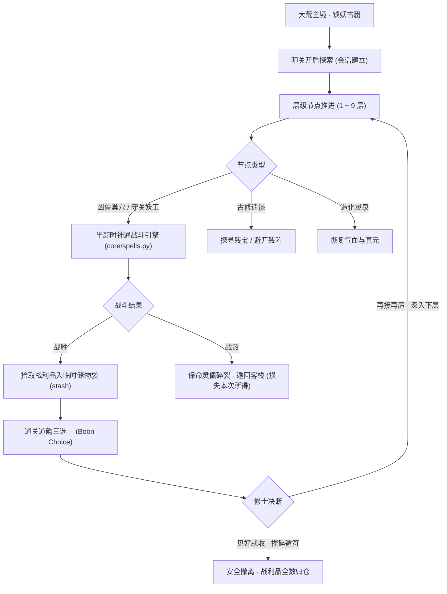

# Spec: 锁妖古窟探秘与五行神通连携战斗系统 (Dungeon & Spells Combat)

## 1. Problem Statement (问题陈述)
目前修仙系统中的「探险」为单次点击消耗 20 灵石并由后台掷骰子判定胜负；「战斗」亦为单纯的数值对比比大小。
玩家缺乏：
1. **步步为营的探索感与阶段性挑战**：没有类似地牢/秘境闯关、层级推进、守关 Boss 挑战的玩法；
2. **策略出招与 Build 搭配**：没有真元与气血管理、五行神通技能、属性克制与技能连携；
3. **局内成长与风险博弈**：没有 Roguelike 局内道韵强化，没有“随时捏符撤离保住收益 vs 冒险深入争夺奇珍”的心理博弈；
4. 导致玩家感觉“每天只是收菜点点点，不知道装备和战力有什么用，实际上缺乏核心玩法”。

---

## 2. Design Proposal (架构与设计方案)

### 2.1 核心架构

### 2.2 核心模块规范
1. **`core/spells.py`（修仙神通引擎）**：
   - 气血（HP）、真元（MP）、护盾（Shield）体系；
   - 五大系基础神通：
     - **金【太乙破虚剑】**：消耗 15 MP，高暴击伤害，对护盾造成 1.5 倍破盾斩击；
     - **木【青帝长生引】**：消耗 20 MP，恢复生命并驱散负面效果；
     - **水【玄冰寒煞魄】**：消耗 18 MP，冰霜伤害并施加【冻结】（使目标下回合停滞）；
     - **火【九幽地煞火】**：消耗 20 MP，附加【灼烧】；若目标处于冻结状态，引发【真火爆燃】双倍额外暴击；
     - **土【不动明王罡】**：消耗 20 MP，生成最大生命 30% 的厚土灵盾，并反震近战伤害。
   - 法宝必杀神通：根据已穿戴的法宝/神兵释放【飞剑·青索穿心】、【翻天玄印】、【阴阳破妄】，每场仅限 1 次，造成巨额伤害。
   - 步进战斗状态机：支持普攻与神通指令步进，输出战斗日志与血量快照。

2. **`core/dungeon.py`（锁妖古窟探秘引擎）**：
   - 9 层梯度设计（1~3 层炼气/筑基，4~6 层筑基/金丹，7~9 层金丹/元婴）；
   - 节点网络生成：凶兽、遗骸、灵泉、守关妖王；
   - 局内道韵池（Dao Boons）：每层通关 3 选 1（纯阳真火、厚土金汤、剑心通明、灵犀步法等）；
   - 临时储物袋（Stash）：探索中掉落物品暂存，安全撤离后原子写入 Character 纳戒；
   - 状态持久化于 `WorldStateRepository`，支持刷新断线重连。

3. **`server/world.py`（服务端接口与投影）**：
   - `/禁地`、`/探秘`、`/施法 <技能>`、`/祭法宝`、`/择道韵 <序号>`、`/撤离`；
   - `_status_dict` 新增 `dungeon`（层数、气血、真元、敌方状态、战报、道韵、待选节点）与 `spells` 投影。

4. **`web/workbench.js` & `web/index.html`（前端水墨画卷）**：
   - 大荒面板切换【大荒寻历】与【锁妖古窟】；
   - 高保真水墨卷轴：双血条/蓝条、五行技能法诀快捷栏、妖兽立绘徽标、战斗气泡飘字、道韵三选一弹窗、一键捏符安全撤离。

---

## 3. Out of Scope (明确不做范围)
1. 不做纯动作类即时微操（依然保持修仙古典半即时策略/回合交互，兼顾手机端与文本端）；
2. 不做多人联机组队下本（首期专注于单人 Roguelike 深度与神通策略体验，多人组队作为第二阶段演进）；
3. 不破坏原有的一键 `/探险` 与 `/挖宝` 挂机产出。

---

## 4. Implementation Tasks (任务拆解)

- [x] **Task 1: 神通与连携战斗核心引擎** (`core/spells.py`, `tests/test_spells.py`)
  - 定义 HP/MP/Shield 与五行神通数值；
  - 实现神通施展、元素连携爆燃/冻结/破盾、法宝必杀与战斗快照生成。
- [x] **Task 2: 锁妖古窟 9 层结构、节点生成与局内道韵系统** (`core/dungeon.py`, `tests/test_dungeon.py`)
  - 构造 9 层妖兽与守关 Boss 数据字典；
  - 构造节点生成逻辑、局内道韵 3 选 1 效果池、临时储物袋与撤离结算机制。
- [x] **Task 3: 服务端接口增强与状态投影** (`server/world.py`, `tests/test_dungeon_world_link.py`)
  - 接入 `/禁地`、`/施法`、`/祭法宝`、`/择道韵`、`/撤离` 等指令；
  - `_status_dict` 增加权威 `dungeon` 与 `spells` 状态输出。
- [x] **Task 4: 前端水墨画卷与半即时出招交互** (`web/index.html`, `web/workbench.js`)
  - 大荒界面新增【锁妖古窟】面板；
  - 渲染水墨秘境卷轴、气血真元槽、五行快捷施法栏、即时战报与道韵卡片。
- [x] **Task 5: 战利品归仓、撤离与死亡惩罚安全闭环** (`core/dungeon.py`, `server/world.py`, `web/workbench.js`)
  - 离线 Demo 模式与在线真实 API 模式双轨一致性；
  - 确保断线重连、背包满格预警、战败遁回客栈的稳健处理。
- [x] **Task 6: 自动化测试套件与全量回归** (`tests/test_dungeon_flow.py`)
  - 编写涵盖神通连携、禁地闯关、道韵加成、安全撤离与濒死惩罚的全链路端到端测试并全量跑通。
