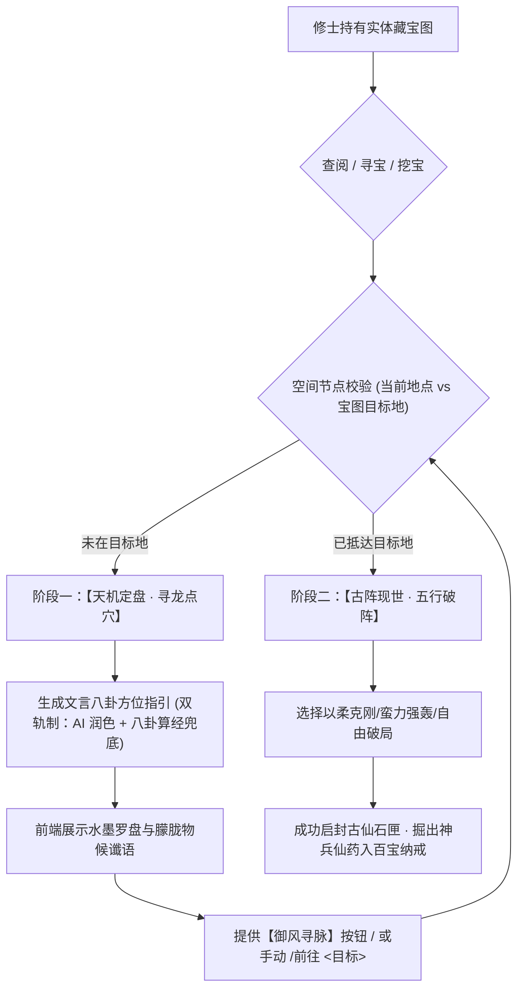

# Spec: 实体藏宝图文言方位指引与寻龙破阵双阶段系统 (Treasure Map Direction Guide)

## 1. Problem Statement (问题根因与痛点陈述)
用户反馈：“在使用藏宝图的时候，似乎一直是失败，没有成功过，检查下是什么问题。如果是游戏设定，AI在返回失败结果的时候，要求其给出方向指引，不需要很明确，用文言语言指引”。

### 深层根因排查：
1. **游戏设定定位**：藏宝图是空间绑定的机缘道具（如 `人品·古修遗图[黑水沼泽]`），设定要求修士必须亲赴所指凶地/灵穴，方能勘探开匣；
2. **前端交互误导**：当前前端在任何地点（如安全区客栈）点击藏宝图寻宝时，直接弹出“青铜石门破阵大典”选项，误导玩家以为宝箱就在眼前；
3. **破阵闭环失败**：玩家在客栈点击“敕令五行破阵”，服务端因地点不符拦截并返回错误，前端弹窗直接判定为“⚠️ 破阵受阻·宝匣未启”，且未把地点不符的原因明确交代给用户，导致玩家以为破阵算法有 bug 或永远失败；
4. **缺乏古典寻龙意境**：目前未在目标地时的提示语为生硬的白话距离数字，缺乏古典仙侠风水定盘、八卦方位、物候灵气的朦胧文言指引。

---

## 2. Design Proposal (架构与解决方案)

### 2.1 整体架构流程

### 2.2 核心模块规范
1. **八卦风水计算与双轨文言指引引擎 (`core/treasure_system.py`)**：
   - 八卦方位映射：基于两地坐标差 `(dx, dy)`，精准映射为八卦方位（坎北、离南、震东、兑西、艮东北、巽东南、坤西南、乾西北）；
   - 距离气机感知：根据路网跳数 `hops` 判定灵气感知（邻山咫尺、百里山川、万水阻隔）；
   - **双轨制生成文言指引**：
     - **AI 动态润色**：当 `ai_ready()` 时，由天机大能提示词生成 60~100 字朦胧唯美的文言寻龙诀；
     - **古典算经离线模板**：内置纯正八卦物候谶语库（玄水沉渊、南明离火、青龙盘木、白虎庚金等），毫秒级响应，零网络风险。
2. **服务端指令与状态投影 (`server/world.py`)**：
   - `/挖宝` 与 `/宝图`：未到目的地时返回详细的文言八卦指引与气机感应，不消耗宝图，不误报开匣受阻；
   - `_status_dict(char)`：向前端 items 注入完整的 `targetNodeName`、`is_at_target`、`direction_hint` 等属性。
3. **前端水墨画卷双阶段改造 (`web/workbench.js`)**：
   - **形态一（未抵达）**：展示天机定盘、磁针方位、文言寻龙谶语，按钮为【御风寻脉 (动身起程)】与【收敛宝图】；
   - **形态二（已抵达）**：展示金光破晓动效，开启三千阵纹五行破阵大典，选择破阵策略并开匣。

---

## 3. Out of Scope (明确不做范围)
1. 不取消“必须到达目标地点才能挖宝”的修仙核心设定（确保空间探索与跑图玩法的意义）；
2. 不直接在文言指引中给出死板的精确数字坐标（保持修仙探秘的朦胧韵味与古典推演感）；
3. 不影响原有的自由文本（`/做`）DM 即兴破阵机制。

---

## 4. Implementation Tasks (任务拆解)

- [ ] **Task 1: 八卦方位风水算法与双轨文言天机指引生成器** (`core/treasure_system.py`, `tests/test_treasure_direction.py`)
  - 实现基于拓扑坐标的八卦方位判定与山川物候匹配；
  - 实现双轨制（AI 天机推演 + 本地八卦算经库）文言指引函数；
  - 编写单元测试验证八个方向、远近跳数及文言输出质量。
- [ ] **Task 2: 寻宝与挖宝空间校验改造与多轮指令契约** (`core/treasure_system.py`, `server/world.py`)
  - 改造 `TreasureEngine.dig` 与 `read_map`，在未到达目标地点时输出文言寻龙指引；
  - 服务端 `_status_dict` 输出藏宝图节点的匹配状态；
  - 编写测试验证未到地点时不损耗宝图并返回文言指引。
- [ ] **Task 3: 前端【天机秘宝 · 风水定盘】双阶段形态与【御风寻脉】直达按钮** (`web/workbench.js`)
  - 改造 `handleTreasureAction`：未在目标地时呈现风水寻龙卷轴，提供一键【御风寻脉】跳转；
  - 到达目标地后呈现五行破阵大典，破除开匣受阻的误解。
- [ ] **Task 4: 全流程端到端自动化测试与全量回归** (`tests/test_treasure_direction_flow.py`)
  - 编写涵盖“获图 -> 寻龙定盘（文言指引） -> 御风前往 -> 破阵开匣 -> 神兵仙药入库”的全闭环端到端测试；
  - 运行全量回归套件确保零历史破坏。
